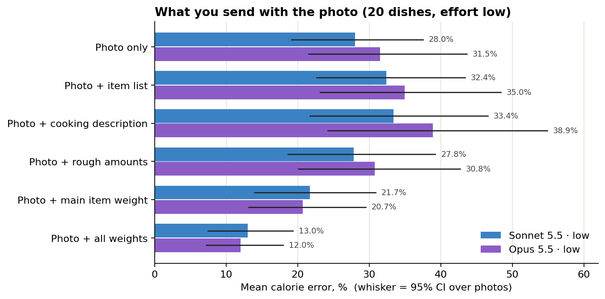

# trackEat

**Count calories and macros from a photo, without a paid app.**

Photograph your meal in a Claude chat. Claude estimates the calories and macros, then writes a row into a
Google Sheet. The sheet adds up each day, week and month, colors your days green, yellow or red against your
target, and draws charts of your weight, calories, protein and waist.

[Open the example](https://docs.google.com/spreadsheets/d/1w05KkzB-qLLtba76uZ9kUNTqpd0JIKgOzFDiLgsRd3g/edit) · [Copy the template](https://docs.google.com/spreadsheets/d/1uqmUvHJyP1vaeMkNlEO43t49wutPF7NhyMWm3-q2o7o/copy) · [Accuracy report with charts](https://artemkagoldman.github.io/trackEat/)

[Get started](#get-started) · [How it works](#how-it-works) · [Accuracy](#how-accurate-is-it) · [FAQ](#faq) · [Українська](README.uk.md)

---

## Why

Calorie apps charge for the useful parts, make you log every item by hand, and their photo recognition is a
black box you can't check. A chat with an AI plus a spreadsheet you own does the same job: you see every
number, you can correct it, and the data stays in your Google Drive.

The catch is that nobody knew how accurate a model is at counting calories from a photo. So I measured it
on 35 photos with known calories, about 4,800 answers from Claude Haiku, Sonnet and Opus
([results](#how-accurate-is-it)). This repository is the sheet, the instructions and that test.

## What you get

| | What it does |
| --- | --- |
| **Log** | One row per meal: date, time, item, grams, kcal, protein, fat, carbs and how it was estimated |
| **Days, weeks, months** | Totals that calculate themselves. A new day appears when you log its first meal |
| **Targets** | Calories, protein, fat and carbs worked out from your weight, height, age, activity and goal |
| **Colors** | Each day is green, yellow or red against your target. You choose how strict it is |
| **Dashboard** | Tiles, a table of the last 7 days and 9 charts: weight, calories, protein, waist, weekly macros |
| **Weight** | A daily weight with a 7-day average, and a weekly waist measurement |

## The sheets

| | Link |
| --- | --- |
| English, with random data for 21 days | [Open](https://docs.google.com/spreadsheets/d/1w05KkzB-qLLtba76uZ9kUNTqpd0JIKgOzFDiLgsRd3g/edit) |
| English, empty template | [Make your own copy](https://docs.google.com/spreadsheets/d/1uqmUvHJyP1vaeMkNlEO43t49wutPF7NhyMWm3-q2o7o/copy) |
| Українська, приклад з даними | [Відкрити](https://docs.google.com/spreadsheets/d/1vx7z_Q0UrMAOrUVHVcDCbLGrZJeHRGuL47_ULDrv6D8/edit) |
| Українська, порожній шаблон | [Створити свою копію](https://docs.google.com/spreadsheets/d/1jmuORnlPcK1LIoxqUPPi2ncdgpgP2BfMlUyLNEWzvJs/copy) |

The examples are read-only. To keep your own data, use the template link: Google asks you to make a copy,
and the copy is yours.

## Get started

You need a Google account and a Claude account. Four steps, once:

1. **Copy the template** with the link above and work only in your copy.
2. **Fill in the Settings tab.** Replace the blue cells with your weight, height, age, activity factor,
   deficit, and protein and fat per kg. The targets calculate themselves. The metabolic rate formula is the
   male one; for women change `+5` to `-161` at the end of the formula in cell B15.
3. **Create a Claude project.** Connect Google Sheets (Settings → Connectors), then paste the text from
   [docs/project-instructions.en.md](docs/project-instructions.en.md) into the project instructions, with the
   link to your copy.
4. **Say "This is the first run"** in the project's first chat. Claude asks about your goal and details and
   fills in the settings.

After that, photograph your meals in that chat. Weigh yourself in the morning and write it on the Weight
tab; measure your waist once a week. Button names in Claude may differ, because the interface changes.

## How it works

1. You send a photo, optionally with a weight or a short description.
2. Claude names the components, estimates their weight, counts the oil and sauces, and shows you the sums.
3. You correct anything that is off and confirm.
4. Claude appends a row to the Log tab. Everything else is formulas.

### Getting more accurate estimates

These come from the test below.

- **Give the weight of the main item**, for example "chicken 150 g". The error per dish drops from about 28%
  to 22%.
- **Give the amount of oil or sauce**, for example "1 tablespoon of oil". Name an item without an amount and
  the model assumes a full portion.
- **Photograph packaged food with the weight label visible.** The model reads it. Weigh nuts: a handful of
  almonds comes out about 40% too low.
- **At fast-food chains, say the size and the drink.**
- **Use Sonnet in standard mode.** Extended thinking made no difference to accuracy.

## How accurate is it?

I tested Claude Haiku 5.5, Sonnet 5.5 and Opus 5.5 on 35 photos: 20 weighed dishes and 15 snacks and branded
products (about 4,800 answers, up to 10 per photo and setting).

| What you send | Mean error per dish (Sonnet 5.5) | Error over a whole day |
| --- | --- | --- |
| Photo and the weight of every item | **13%** | 6% |
| Photo and the weight of the main item | 22% | 9% |
| Photo only | 28% | 13% |
| Photo and a list of items without amounts | 32% | 14% |
| Photo and a cooking description without amounts | 33% | 14% |

- **Sonnet is the most accurate on dishes** (28% from a photo alone), Opus is a little better on snacks
  (about 12%), and Haiku overestimates (about 41%) and makes gross mistakes.
- **A single dish from a photo alone can be off by a quarter or more.** Over a day the errors partly cancel
  out, to about 13%. That is enough to see a trend, not to count every calorie.
- **A packaged Snickers or Mars comes out almost exactly**, a Big Mac within 5%.
- **Describing a dish without amounts makes it worse**, because the model adds a full portion of everything
  you name.

Interactive report with charts, every model and setting, and confidence intervals: **[artemkagoldman.github.io/trackEat](https://artemkagoldman.github.io/trackEat/)**. Text version: [docs/benchmark.en.md](docs/benchmark.en.md).
Code and every answer: [benchmark/](benchmark/).

## FAQ

Is it free?

 

The sheets and the instructions are free to copy. You need a Claude account to use the chat, and Google Sheets
is free. I haven't checked which Claude plans include projects and connectors, so look at the plan page.

Can I use another AI or another language?

 

The test covers only Claude, so I can't say how accurate others are. The sheet comes in English and
Ukrainian. For any other language, change the text in the instructions and the tab names stay as they are.

Where does my data go?

 

Your photos go to Claude in the chat. The sheet lives in your own Google Drive and is private until you
share it. This repository holds no personal data; the examples use random numbers.

Why not a Telegram bot or an app?

 

A bot needs an API key that bills per photo (about $6 per 1,000 photos with Sonnet) and a server to run on,
and it would use the same model. A Claude project with a sheet needs neither.

I have my own goal, such as gaining muscle

 

Say so in the first chat. Claude picks the targets to fit it: a deficit to lose fat, a surplus to gain,
zero to maintain.

## Documentation

| | |
| --- | --- |
| [Accuracy test](docs/benchmark.en.md) | Method, every result table and the limits of the test (also [in Ukrainian](docs/benchmark.uk.md)) |
| [Project instructions](docs/project-instructions.en.md) | The text to paste into a Claude project (also [in Ukrainian](docs/project-instructions.uk.md)) |
| [benchmark/](benchmark/) | The test scripts, the dataset, all model answers and the result tables |

## Limitations

- These are rough guides, not medical advice. A photo estimate does not replace weighing.
- The test used top-down cafeteria photos and a few branded products. Ordinary phone photos taken at an angle
  may give different results.
- 35 photos is a small sample, so the confidence intervals are wide.
- The reference calories come from USDA tables for weighed ingredients, so they have an error of their own.

## Credits

- Dishes and snacks from [Nutrition5k](https://github.com/google-research-datasets/Nutrition5k) (Google
  Research, CC BY 4.0).
- Branded product photos from Wikimedia Commons. Licenses and links are in `benchmark/dataset.json`; the
  photos themselves are not included.
- Big Mac, fries and Coca-Cola calories from the McDonald's Ukraine website.
