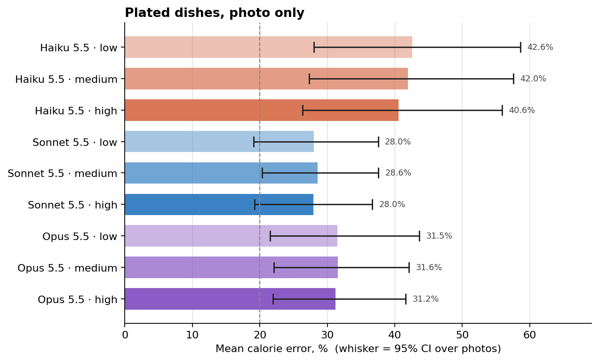
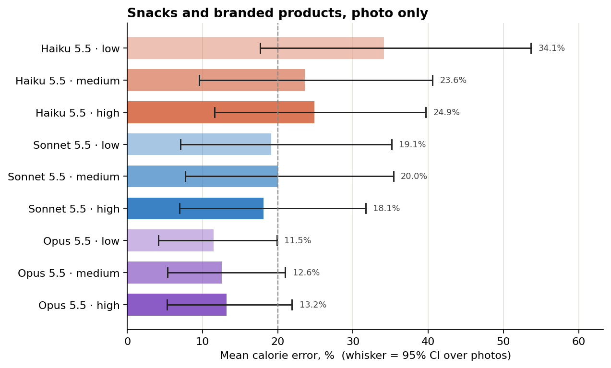
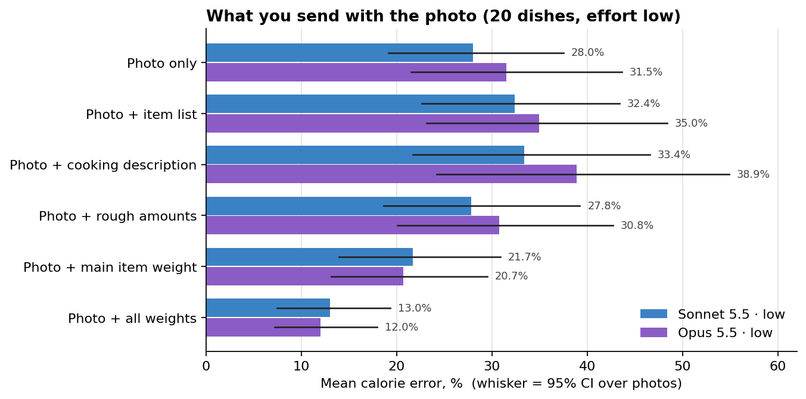
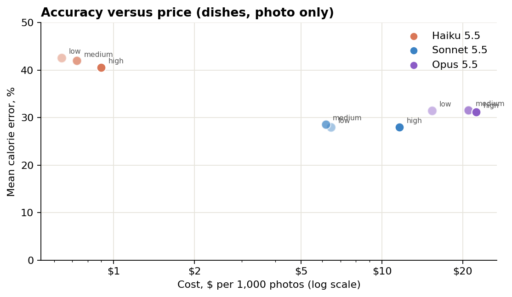
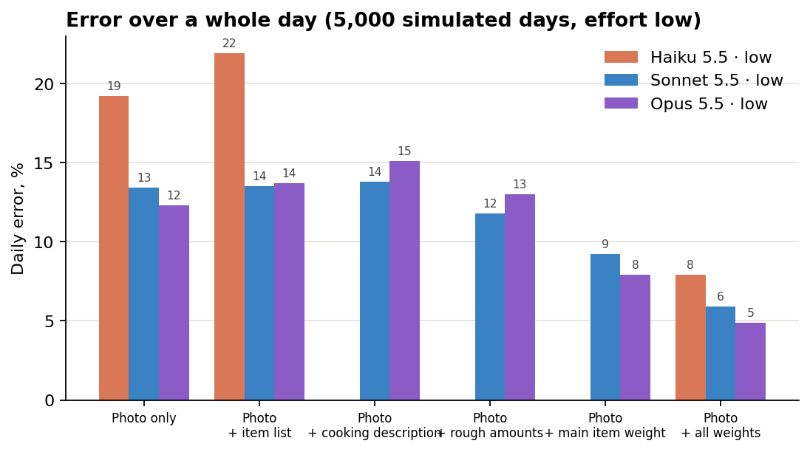
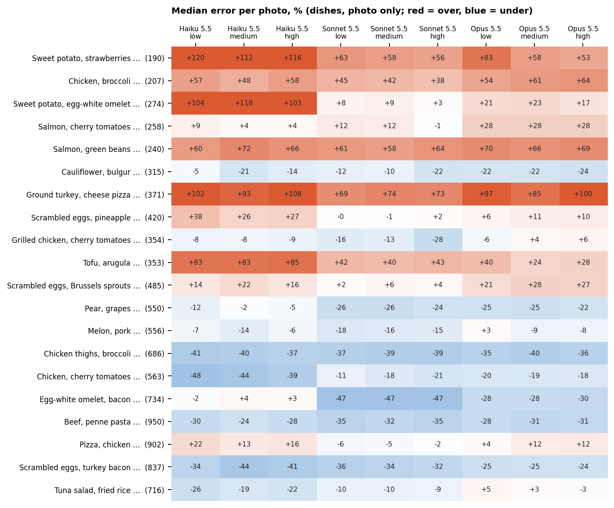

# Accuracy test: Claude counting calories from photos

**English** · [Українська](benchmark.uk.md)

## What was tested

How accurately Claude Haiku 5.5, Sonnet 5.5 and Opus 5.5 estimate calories and macros from food photos, and how this depends on the effort level (low, medium, high) and on extra information given with the photo.

## Data

- **35 photos with known calories:**
  - 20 plated dishes from the [Nutrition5k](https://github.com/google-research-datasets/Nutrition5k) dataset (Google Research, CC BY 4.0). Every ingredient was weighed, with calories and macros computed from the USDA database. Dishes range from ~190 to ~950 kcal.
  - 8 snacks from Nutrition5k: almonds in different amounts, an apple, cookies, a brownie.
  - 7 branded products from Wikimedia Commons: Snickers, Mars, Twix, Oreo, Milka, a Big Mac and a Big Mac meal. Ground truth comes from the label in the photo or official data; for McDonald's from the McDonald's Ukraine website (Big Mac 526 kcal, medium fries 330 kcal, Coca-Cola 0.4 L 163 kcal).
- **~4,800 model responses.** Up to 10 responses per photo and configuration.
- Requests ran through Claude Code with no tools and the same system prompt. The prompt asks the model to identify components, estimate weight, account for oil and sauces, and return JSON with calories and macros.

## Method

- Response error = |estimate − truth| / truth. A configuration's mean error is the mean over photos, each photo weighted equally.
- The 95% confidence interval is a bootstrap over photos (2,000 resamples). Responses for one photo are similar to each other, so the sampling unit is the photo, not the response.
- "Bias" is the mean signed error: positive means overestimation.
- Daily error is a simulation of 5,000 days: 3 random dishes and 1 snack, one random response per meal.

## Results

### Plated dishes, photo only

| Model | Effort | Mean error | 95% CI | Within ±20% | Bias |
|---|---|---|---|---|---|
| Haiku 5.5 | low | 42.6% | 28.0–58.6 | 35% | +21% |
| Haiku 5.5 | medium | 42.0% | 27.3–57.5 | 36% | +19% |
| Haiku 5.5 | high | 40.6% | 26.4–55.9 | 36% | +19% |
| Sonnet 5.5 | low | **28.0%** | 19.1–37.5 | 44% | +3% |
| Sonnet 5.5 | medium | 28.6% | 20.4–37.6 | 44% | +3% |
| Sonnet 5.5 | high | 28.0% | 19.3–36.7 | 39% | +1% |
| Opus 5.5 | low | 31.5% | 21.5–43.6 | 36% | +12% |
| Opus 5.5 | medium | 31.6% | 22.1–42.1 | 33% | +11% |
| Opus 5.5 | high | 31.2% | 21.9–41.6 | 34% | +12% |

Effort barely affects accuracy, while high makes the response twice as long and more expensive. Sonnet is the most accurate and hardly overestimates.

### Snacks and branded products, photo only

| Model | Effort | Mean error | 95% CI | Within ±20% |
|---|---|---|---|---|
| Haiku 5.5 | low / medium / high | 34% / 24% / 25% | 10–54 | 54–67% |
| Sonnet 5.5 | low / medium / high | 19% / 20% / 18% | 7–35 | 68–73% |
| Opus 5.5 | low / medium / high | **11.5%** / 12.6% / 13.2% | 4–22 | 76–80% |

On snacks Opus is more accurate. Packaged food with a label (Snickers, Mars) comes out almost exactly because the model reads the weight and kcal from the label. Handfuls of nuts are underestimated by about 40%.

### What to send with the photo (dishes, Sonnet 5.5, effort low)

| What was sent | Mean error | Bias | Daily error |
|---|---|---|---|
| Photo + weight of every item | **13.0%** | +3% | 5.9% |
| Photo + weight of the main item only | 21.7% | +4% | 9.2% |
| Photo + rough amounts ("medium portion") | 27.8% | +14% | 11.9% |
| Photo only | 28.0% | +3% | 13.4% |
| Photo + list of items without amounts | 32.4% | +7% | 13.7% |
| Photo + cooking description with oil and sauces, no amounts | 33.4% | +13% | 13.6% |

Opus shows a similar pattern: main item weight 20.7%, everything weighed 12.0%, list without amounts 35%, cooking description 39%.

Conclusion: a list of items or a cooking description without amounts does not help and actually hurts, because the model assumes a full portion of each named item and a lot of oil. Only weight helps.

### Macros, time and cost (dishes, photo only)

Error of protein, fat and carbohydrates is the total absolute gram error divided by total true grams. Macros are harder than calories: fat is the weakest.

| Model | Effort | Protein error | Fat error | Carbs error | Time, s | $ per 1,000 photos |
|---|---|---|---|---|---|---|
| Haiku 5.5 | low | 36% | 45% | 48% | 6.9 | 0.64 |
| Haiku 5.5 | medium | 35% | 43% | 43% | 8.0 | 0.73 |
| Haiku 5.5 | high | 34% | 43% | 44% | 9.6 | 0.90 |
| Sonnet 5.5 | low | 28% | 37% | 31% | 5.2 | 6.46 |
| Sonnet 5.5 | medium | 28% | 38% | 30% | 5.3 | 6.17 |
| Sonnet 5.5 | high | 27% | 37% | 31% | 9.5 | 11.64 |
| Opus 5.5 | low | 26% | 35% | 35% | 7.2 | 15.40 |
| Opus 5.5 | medium | 27% | 36% | 36% | 10.3 | 21.02 |
| Opus 5.5 | high | 27% | 36% | 37% | 11.1 | 22.44 |

### Cost and speed

At API prices: Haiku ~$0.6–0.9, Sonnet ~$6–12, Opus ~$15–22 per 1,000 photos (photo only). A response takes 5–11 seconds. In Claude chat on a subscription, individual photos are not billed separately.

### Over a whole day

Errors of single meals partly cancel, so the daily error is about half of the per-dish error.

### Every photo separately

The median of up to 10 responses per photo, in % of the true calories. All models overestimate light dishes (sweet potato, salmon with beans, pizza with turkey) and underestimate heavy ones (beef with pasta, chicken thighs): they are pulled toward the middle. Sonnet is least biased, Haiku overestimates most.

An interactive version with all tables: **https://artemkagoldman.github.io/trackEat/**

## Conclusions

- Use **Sonnet 5.5 in standard mode**.
- A single dish from a photo alone: ~±28%. Over a day, when errors partly cancel out: ~13%.
- Give the weight of the main item and the amount of oil and sauces.
- Haiku is not recommended: it overestimates and makes gross errors (a doubled Twix).

## Limitations

- Nutrition5k photos are taken strictly from above on identical plates. Ordinary angled phone photos may give different results.
- 35 photos is a small sample, so the intervals are wide. A difference between configurations whose intervals overlap may be random.
- The Nutrition5k ground truth has its own error (USDA tables).
- The cooking description, rough amounts and main-item weight modes were tested only on Sonnet and Opus at effort low, with 5 responses per photo.
- The advice "state the amount of oil" follows from the result of the no-amounts mode; it was not tested separately.

## Reproducing

Code and data are in [benchmark/](../benchmark/): `run_bench.py` (runs the test through the Claude Code CLI), `analyze.py` (computes the tables), `dataset.json` (ground truth and sources), `results.jsonl` (all model responses), `out/` (result tables as CSV and JSON), `make_charts.py` (the PNG charts in this report) and `build_site.py` (the interactive page). Photos are not included for license reasons: `download_images.py` downloads the Nutrition5k photos, and for branded products the photo links are in `dataset.json`.
